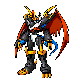
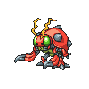
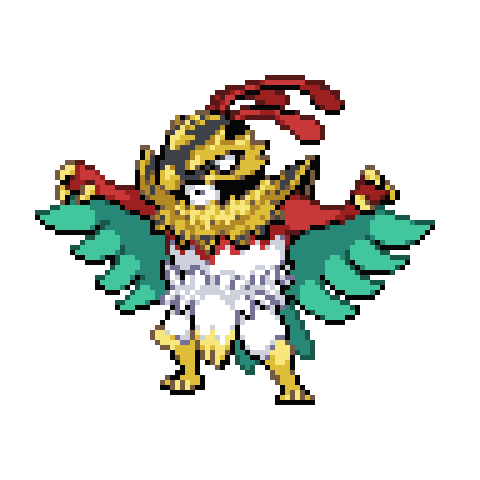

<div align="center">


<br>

[](https://git.io/typing-svg)

<br>

[](https://github.com/FilippiMnz)
[](https://github.com/SerigyHackerClub)

</div>

---

## `> whoami`


```bash
┌──(smith㉿github)-[~]
└─$ whoami
l1pSm1th
┌──(smith㉿github)-[~]
└─$
```
Computer Science student at **Federal University of Sergipe (UFS)**, focused on **Offensive Security, Web Application Security and Purple Team operations**.

Interested in understanding how systems fail, how vulnerabilities can be chained, and how offensive techniques can contribute to stronger defenses.

```yaml
alias: L1PSM1TH
field: Cybersecurity
focus:
  - Offensive Security
  - Web Application Pentesting
  - Purple Team
  - Adversary Simulation
interests:
  - Security Research
  - Threat Intelligence
  - Vulnerability Analysis
  - CTFs
```

-  Offensive Security & Web Application Pentesting
-  Co-founder of **[Serigy Hacker Club](https://github.com/SerigyHackerClub)**
-  CTF player with competitive experience
-  Cybersecurity speaker at AFK
-  Member at Sergipe/Bahia cybersecurity community
-  Portuguese · English · Spanish (Beginner) · Russian (Beginner)

<br clear="both"/>

<div align="center">







</div>

---

## `> operational_highlights`

<div align="center">

| | Highlight | |
|:---:|:---|:---:|
|  | **Certified Red Team Analyst (CRTA)** | Certified |
|  | **AFK** | Speaker |
|  | **Serigy Hacker Club** | Co-founder |
|  | **CTFs** | Player |

</div>

```bash
┌──(smith㉿github)-[~/achievements]
└─$ cat status.log

[+] Competitive hacking
[+] Offensive security training
[+] Cybersecurity research
[+] Community building
[+] Knowledge sharing
┌──(smith㉿github)-[~]
└─$
```

---

## `> arsenal`

<div align="center">

### ⚔️ Offensive Security


###  Tools & Environment


###  Programming


###  Infrastructure & Development


</div>

---

## `> battlefield`

<div align="center">

<a href="https://app.hackthebox.com/users/SEU_ID">

</a>

<a href="https://tryhackme.com/p/SMITH">

</a>

<a href="https://pwn.college/hacker/SMITH">

</a>

<a href="https://play.picoctf.org/users/SMITH">

</a>


</div>

---

## `> talks & research`

###  PEBKAC — A Criptografia Nunca Foi o Problema

**AFK · Offensive Security / Ransomware**

Exploring how human mistakes, flawed implementations, poor key management and operational failures can undermine cryptographic systems used in ransomware.

###  Extração de Inteligência de Ameaças Cibernéticas com Poucos Dados

**AFK · Threat Intelligence**

Investigating how useful threat intelligence can be extracted, correlated and interpreted even when working with limited data sources.

---

## `> certifications`

###  Professional Certification

- **Certified Red Team Analyst (CRTA)** — CyberWarFare Labs

###  Courses & Training

- Google Cybersecurity Professional Certificate — 124h
- Hackers do Bem — Nivelamento (80h)
- Hackers do Bem — Básico (64h)
- Cisco Networking Basics
- Cisco Introduction to Cybersecurity

###  Currently Exploring

- PortSwigger Web Security Academy
- Pacific Sec — Offensive Security Training
- Cisco Junior Cybersecurity Analyst Career Path

---

## `> github activity`

<div align="center">


</div>

<div align="center">

[](https://github.com/ashutosh00710/github-readme-activity-graph)

</div>

---

## `> connect`

<div align="center">


<a href="https://github.com/SerigyHackerClub">

</a>


</div>

---

<div align="center">


<br>

**— SMITH**


</div>
