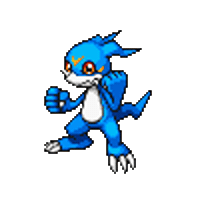
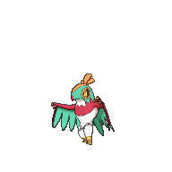

---

## `> whoami`

Computer Science student at **UFS** (Federal University of Sergipe), focused on **offensive security**, **Purple Team** and web application pentesting. I use Burp Suite on a regular basis and like turning CTF-style problems into real-world skills.

-  One of the founders of **[SerigyHC](https://github.com/SerigyHackerClub)** , a hacker club in Sergipe built together with a great crew
-  CTF player
-  Part of the Sergipe/Bahia cybersecurity scene: Raul Hacker Club, AxéSec and AFK
-  Portuguese (native), English, Spanish and Russian (beginner)

  
  
  
  
  

## `> talks`

Both at **AFK**:

- **PEBKAC – A Criptografia Nunca Foi o Problema**: how human mistakes defeat cryptographic implementations in ransomware
- **Extração de inteligência de ameaças cibernéticas com poucos dados**

## `> certs`

**Completed**
- Certified Red Team Analyst (**CRTA**)
- Google Cybersecurity Professional Certificate (124h)
- Cisco Networking Basics and Cisco Introduction to Cybersecurity
- Hackers do Bem: Nivelamento (80h) and Básico (64h)

**In progress**
- PortSwigger Web Security Academy
- Offensive Security training at Pacific Sec
- Cisco Junior Cybersecurity Analyst Career Path (CCST)

## `> labs & ctfs`

<!-- Streaks: descomente quando os SVGs estiverem na branch "output"

  
  
  

-->

---

## `> git activity`

  
  

<!-- Snake: descomente depois de rodar o workflow snake.yml uma vez

  <picture>
    <source media="(prefers-color-scheme: dark)" srcset="https://raw.githubusercontent.com/FilippiMnz/FilippiMnz/output/github-snake-dark.svg" />
    
  </picture>

-->

### Security:
&nbsp;
&nbsp;
&nbsp;

### Main skills:
&nbsp;
&nbsp;
&nbsp;
&nbsp;
&nbsp;

### Tools:
&nbsp;
&nbsp;
&nbsp;
&nbsp;
&nbsp;

### Other Knowledge:
&nbsp;
&nbsp;
&nbsp;
&nbsp;
&nbsp;

### Studying in this moment:
&nbsp;
&nbsp;
&nbsp;

